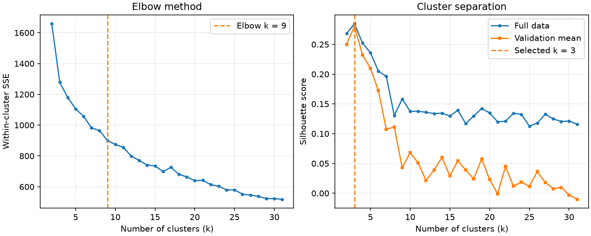

# Wine 数据集上的 K-means 聚类

使用 scikit-learn 内置的 Wine 数据集，共 178 个样本、13 个特征和 3 个类别。算法用 NumPy 实现，scikit-learn 用于加载数据、划分数据、标准化和计算指标。

## 运行

在仓库根目录运行以下命令。本次实验在 Python 3.12 下验证。

```sh
python -m pip install -r requirements.txt
python main.py
```

`kmeans.py` 实现算法，`main.py` 运行实验。程序打印各个 k 的评估结果，并在代码目录更新图表。实验固定随机种子为 42。

## 实验方法与结果

K-means 交替执行最近中心分配和簇内均值更新。每个 k 随机初始化 10 次，保留簇内平方和（SSE）最小的结果。对标准化特征逐一评估 k=2～31，比较全量数据的 SSE 和轮廓系数。

另外做 5 折验证。每折只用训练特征计算标准化参数和聚类中心，再把验证样本分配到最近中心并计算验证轮廓系数。训练和选 k 的过程只使用特征。

**选择 k=3。** 归一化 SSE 曲线与两端连线的偏离在 k=9 时最大，但 k 从 2 增到 3 时，SSE 已从 1659.01 降到 1277.93。k=3 的全量轮廓系数为 0.2849，5 折平均验证轮廓系数为 0.2804，标准差为 0.0437，两项轮廓系数都在搜索范围内最高。相比之下，k=9 的平均验证轮廓系数仅为 0.0429，因此选择在验证数据上分离效果更好的 3 簇。选定后才用真实标签做外部评估，调整兰德指数（ARI）为 0.8975。


